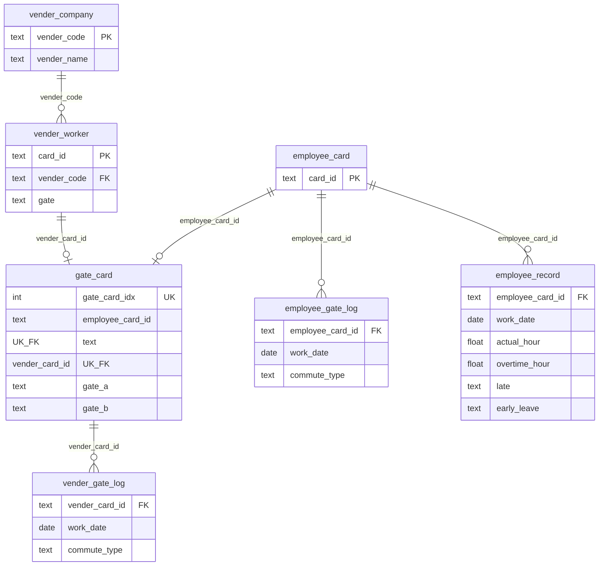
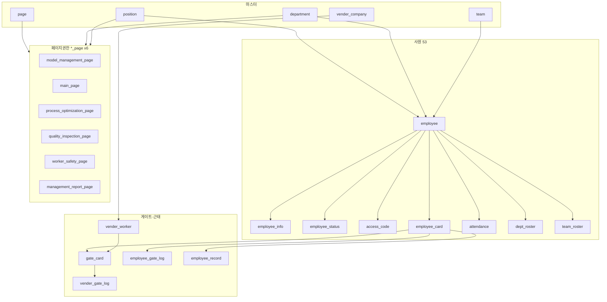

# 조직·권한 테이블 구조 명세

담당: DH · 작성: 2026-11-15 · 갱신: 2026-11-16  
범위: 컬럼·제약·관계·목업·**생성규칙**.  
SoT: DB `aiax` · schema **`org`**. DDL/시드 = `DH/data/sql/*.pg.sql`.  
규칙 엔진 = `DH/api/common/org_permission_logic.py` (Postgres 함수 아님).

| 관련 파일 | 경로 |
|-----------|------|
| DDL | `DH/data/sql/01_org_permission_schema.pg.sql` (`MS/db/init/09_…`) |
| 시드 | `DH/data/sql/02_org_permission_seed.pg.sql` (`MS/db/init/10_…`) |
| dbdiagram | `DH/data/sql/org_permission.dbml` (`position`→`job_position`) |
| 근태·게이트 계산 | `DH/api/common/org_permission_logic.py` |
| 인수인계 | [`조직권한_인수인계.md`](조직권한_인수인계.md) |

---

## 전제

| 항목 | 내용 |
|------|------|
| 스키마 | `org` |
| 테이블명 | ASCII. 예약어 `position` → `"position"` |
| `{table}_idx` | UNIQUE (자연키 PK와 별도) |
| `created_at` | `timestamptz NOT NULL DEFAULT now()` |
| 날짜·시각 | `work_date`=`date`, clock/logout=`timestamptz` |
| 페이지 권한 | 행이 있는 조합만 허용. `access_level` = `read` \| `edit` \| NULL |
| 페이지 목업 | `*_page` 각 **5행** 예시 |
| `access_code` 계산 | 시드 산식 (로직 모듈에 없음) |
| late / early_leave | 컬럼만. **자동 판정 로직 없음**. 시드 예시값 가능 |

---

## 1. `org."position"`

| 컬럼 | 제약 |
|------|------|
| `position_idx` | UNIQUE |
| `position_name` | PK |
| `position_code` | UNIQUE (100~700) |
| `created_at` | |

값: 인턴100 · 사원200 · 대리300 · 과장400 · 차장500 · 부장600 · 소장700 (7행)

---

## 2. `org.department`

| 컬럼 | 제약 |
|------|------|
| `department_idx` | UNIQUE |
| `dept_code` | PK |
| `dept_name` | NOT NULL |
| `department_representative` | NULL → employee_no (순환 FK) |
| `created_at` | |

| dept_code | 이름 | 목업 인원 |
|-----------|------|-----------|
| 10 | 경영부 | 5 (김지환) |
| 20 | 설비부 | 9 |
| 30 | 생산부 | 18 (임광철) |
| 40 | 시스템개발부 | 5 (김도협, 임민섭) |
| 50 | 안전부 | 3 (김혜진) |
| 60 | 품질부 | 10 (임태민) |
| 70 | R&D부 | 3 |

합 **53**.

---

## 3. `org.team`

| 컬럼 | 제약 |
|------|------|
| `team_idx` | UNIQUE |
| `team_code` | PK |
| `team_representative` | NULL → employee_no |
| `created_at` | |

team_code: casting1/2/3(각13) · maintenance(4) · cost(4) · TF(6). 합 53, 미배정 0.  
팀장 권한 숫자는 `access_code`에서 +1 (team 테이블이 권한 FK 아님).

---

## 4. `org.employee`

| 컬럼 | 제약 |
|------|------|
| `employee_idx` | UNIQUE |
| `employee_no` | PK (예 `E30002`) |
| `dept_code` | FK department NOT NULL |
| `position_name` | FK `"position"` NOT NULL |
| `team_code` | FK team NULL |
| `created_at` | |

---

## 5. `org.employee_info` (1:1)

| 컬럼 | 제약 |
|------|------|
| `employee_info_idx` | UNIQUE |
| `employee_no` | PK FK employee |
| `employee_name`, `age`, `gender`, `phone`, `address`, `email` | NOT NULL |
| `created_at` | |

`employment_status` 컬럼 **없음**.

---

## 6. `org.employee_status` (1:1 · 예시 5행)

| 컬럼 | 규칙 |
|------|------|
| `employee_status_idx` | UNIQUE |
| `employee_no` | PK FK |
| `monthly_overtime_hour` | record actual−10, ≤0이면 null |
| `last_logout_at` | 최후 clock_out_at |
| `annual_leave_used` | absent 시 +1, 0~15 |
| `years_of_service` | 오늘 − employee.created_at |
| `created_at` | |

---

## 7. `org.employee_card` (예시 5행)

| 컬럼 | 제약 |
|------|------|
| `employee_card_idx` | UNIQUE |
| `card_id` | PK (예 `EMPE10001`) |
| `employee_no` | UNIQUE FK |
| `attendance_status` | `present` \| `absent` |
| `created_at` | |

---

## 8. `org.attendance` (예시 5행)

PK `(employee_no, work_date)`. FK employee. `work_date` = `date`.

---

## 9. `org.access_code` (53행)

| 컬럼 | 제약 |
|------|------|
| `access_code_idx` | UNIQUE |
| `employee_no` | PK FK |
| `access_code` | 정수 |
| `created_at` | |

**생성규칙(시드):** `dept*10 + position_code/100`, 팀장 +1, 소장 700.

---

## 10. `org.page` (6행)

| page_code | page_name |
|-----------|-----------|
| model_management | 모델관리 |
| main | 메인 |
| process_optimization | 공정최적화 |
| quality_inspection | 품질검사 |
| worker_safety | 작업자안전 |
| management_report | 경영보고 |

---

## 11. `org.*_page` 권한 6종 (각 5행)

공통: `{t}_idx`, `page_code` FK→page, `dept_code`, `position_name`, `page_feature`, `access_level`, `created_at`  
PK: `(dept_code, position_name, page_feature)`

테이블: `model_management_page`, `main_page`, `process_optimization_page`, `quality_inspection_page`, `worker_safety_page`, `management_report_page`

---

## 12. `org.dept_roster` / `org.team_roster` (각 53)

단일 명단. `employee_no` UNIQUE. dept_code / team_code로 구분.

---

## 13. `org.vender_company` (2행)

| vender_code | vender_name | contract_status |
|-------------|-------------|-----------------|
| HB260601 | (주)한빛정밀 | active |
| DS260601 | 대성기공 | active |

`vender_code` = 앞2글자 + 계약일 yymmdd.

---

## 14. `org.vender_worker` (5행)

**employee FK 없음.** `vender_code`만 상속.

| 컬럼 | 제약 |
|------|------|
| `card_id` | PK — `{앞2소문자}{yymmdd}{a\|b}` |
| `card_issued_at` | NOT NULL |
| `card_returned_at` | NULL |
| `gate` | `a` \| `b` |

---

## 15. `org.gate_card` (5행)

| 컬럼 | 제약 |
|------|------|
| `employee_card_id` | FK employee_card NULL UNIQUE |
| `vender_card_id` | FK vender_worker NULL UNIQUE |
| `gate_a` / `gate_b` | `'O'` 또는 NULL |

규칙: 사원 카드 → 양쪽 O. vender 끝 a→gate_a만 O / 끝 b→gate_b만 O.

---

## 16. `org.employee_gate_log` (5행)

`employee_card_id`, `work_date`, `clock_in_at`/`clock_out_at`(NULL 가능), `commute_type` IN\|OUT.

---

## 17. `org.vender_gate_log` (5행)

`vender_card_id` FK → **`gate_card.vender_card_id`**. 동일 출입 컬럼.

---

## 18. `org.employee_record` (5행)

| 컬럼 | 의미 |
|------|------|
| `actual_hour` | 출근~퇴근 (`compute_actual_hour`) |
| `overtime_hour` | actual−9, ≤0이면 null |
| `late` / `early_leave` / `absent` / `work_deficit` | nullable. 사유 없음. 자동 판정 로직 없음 |

---

## 관계 요약

```text
org."position" / department / team ── employee
  ├── employee_info, employee_status, access_code (1:1)
  ├── employee_card ── gate_card.employee_card_id
  │                 ── employee_gate_log
  │                 ── employee_record
  ├── attendance, dept_roster, team_roster

page ── page_code ──► *_page ×6

vender_company ── vender_worker.card_id
                     ── gate_card.vender_card_id ── vender_gate_log
```

dbdiagram: [`DH/data/sql/org_permission.dbml`](../DH/data/sql/org_permission.dbml)

---

## 테이블 구조도 (schema `org`)

### A. 조직·사원

```mermaid
erDiagram
  job_position["position"] ||--o{ employee : position_name
  department ||--o{ employee : dept_code
  team ||--o{ employee : team_code
  department ||--o{ dept_roster : dept_code
  team ||--o{ team_roster : team_code
  employee ||--|| employee_info : employee_no
  employee ||--|| employee_status : employee_no
  employee ||--|| access_code : employee_no
  employee ||--|| employee_card : employee_no
  employee ||--o{ attendance : employee_no
  employee ||--|| dept_roster : employee_no
  employee ||--|| team_roster : employee_no

  job_position {
    int position_idx UK
    text position_name PK
    int position_code UK
  }
  department {
    text dept_code PK
    text dept_name
  }
  team {
    text team_code PK
  }
  employee {
    text employee_no PK
    text dept_code FK
    text position_name FK
    text team_code FK
  }
  employee_info {
    text employee_no PK_FK
    text employee_name
  }
  employee_status {
    text employee_no PK_FK
    float monthly_overtime_hour
    int annual_leave_used
    int years_of_service
  }
  access_code {
    text employee_no PK_FK
    int access_code
  }
  employee_card {
    text card_id PK
    text employee_no UK_FK
  }
  attendance {
    text employee_no FK
    date work_date
  }
  dept_roster {
    text dept_code FK
    text employee_no UK_FK
  }
  team_roster {
    text team_code FK
    text employee_no UK_FK
  }
```

### B. 페이지 권한

```mermaid
erDiagram
  page ||--o{ model_management_page : page_code
  page ||--o{ main_page : page_code
  page ||--o{ process_optimization_page : page_code
  page ||--o{ quality_inspection_page : page_code
  page ||--o{ worker_safety_page : page_code
  page ||--o{ management_report_page : page_code
  department ||--o{ model_management_page : dept_code
  job_position["position"] ||--o{ model_management_page : position_name

  page {
    text page_code PK
    text page_name
  }
  model_management_page {
    text page_code FK
    text dept_code FK
    text position_name FK
    text page_feature
    text access_level
  }
```

`*_page` 6종 동일 PK `(dept_code, position_name, page_feature)`. 위는 model_management만 대표.

### C. 하청·게이트·근태



### D. 한눈에 (영역)



---

## 목업 규모

| 구분 | 행 |
|------|-----|
| employee / info / access_code / rosters | 53 |
| position 7 · department 7 · team 6 · page 6 | |
| vender_company | 2 |
| card / status / attendance / worker / gate / logs / record | 각 5 |
| `*_page` × 6 | 각 5 |
