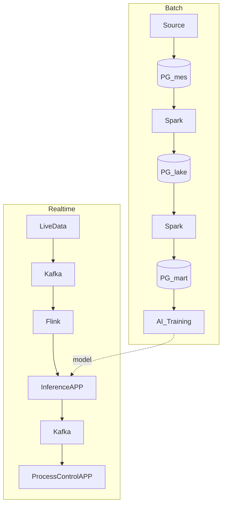
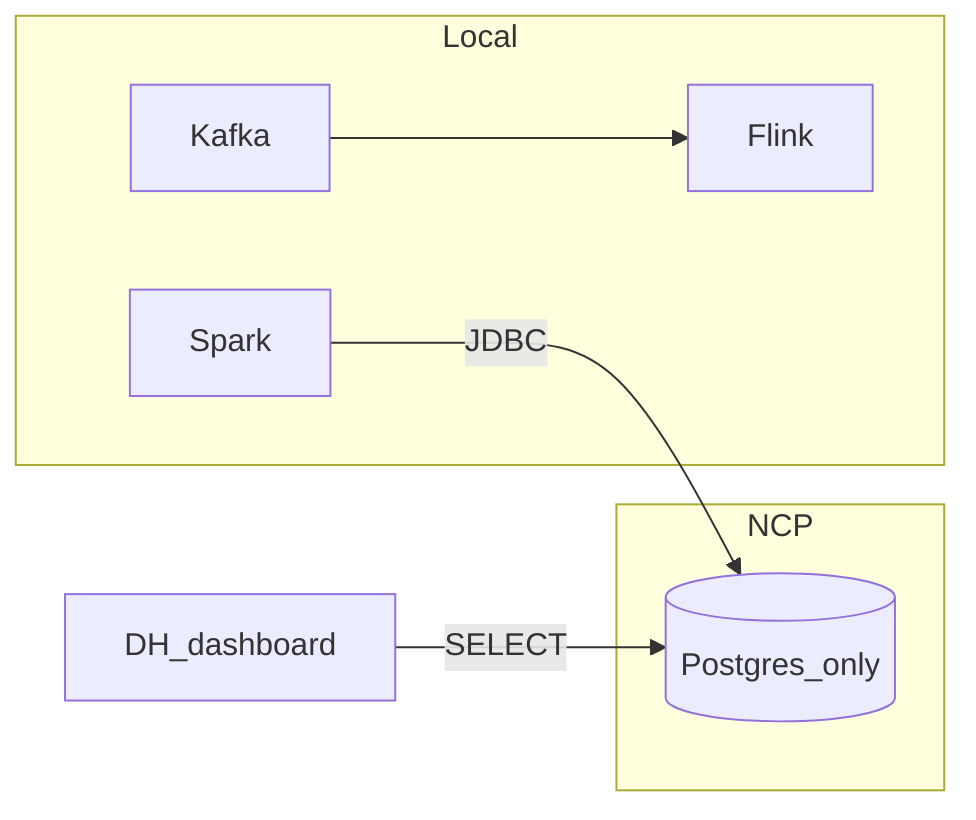

# 데이터 파이프라인

| 항목 | 내용 |
|------|------|
| 작성일 | 2026-11-10 |
| 목적 | PG · Kafka · Spark · Flink **역할**, **사용·제약**, **선택 이유·인프라**를 한곳에 요약 |
| 근거 | [`MS/db/README.md`](../MS/db/README.md), 팀 데이터 흐름 그림 |
| 성격 | **이해·운영 가이드** — 이 문서만으로 새 기능·라이브러리 설치를 하라는 지시 아님 |
| 소유 | 문서·DH 대시보드·`DB연동_내역` → **DH** / Spark·Flink 잡·Compose 본구현 → **MS** |

관련 규칙: [AGENTS.md](../AGENTS.md).

---

## 1. 기능 — 역할과 흐름

### 1.1 DB는 하나

| 구분 | 내용 |
|------|------|
| DB | **PostgreSQL 하나** (`aiax`) |
| `mes` / `lake` / `mart` | **스키마** (칸막이). DB가 3~4개가 아님 |
| Kafka · Spark · Flink | DB 아님 (버퍼 / 처리 엔진) |

### 1.2 구성요소

| 이름 | 역할 | 하지 않는 것 |
|------|------|----------------|
| **PostgreSQL** | `mes` 원본 · `lake` 정제 · `mart` 학습·분석 저장 | 실시간 버퍼 |
| **Kafka** | 실시간 메시지 버퍼 → 구독자에게 전달 | 메타 DB. **스스로 PG에 쓰지 않음** |
| **Spark** | **잡 실행 시** PG 읽어 `lake`/`mart` 적재 | AI 저장소 자체 (`mart`가 학습용 저장) |
| **Flink** | Kafka 구독 → 전처리 → **Inference** | PG 포트 감시. **기본 DB 자동 저장 없음** |

| 한 줄 | |
|--------|--|
| Postgres | 저장 |
| Kafka | 실시간 전달 버퍼 |
| Spark | 배치로 lake/mart를 채우는 일꾼 |
| Flink | 실시간 전처리 후 Inference로 넘기는 일꾼 |

**현황:** Compose 설비는 있음. 생산/Inference/공정제어 **앱**과 Spark·Flink **잡 코드**는 아직 없는 단계가 기본. lake/mart는 시험 SQL 복사 이력 있음 → 정식은 Spark 잡.

### 1.3 데이터 흐름

### 1.4 잡 · 연결 · meta · DH

| 주제 | 요지 |
|------|------|
| **잡** | 엔진에 넣는 **한 번**의 작업 지시. 실행할 때마다 읽기·처리. 안 돌리면 DB를 계속 안 읽음 |
| **Spark↔PG** | JDBC **pull** |
| **Flink↔Kafka** | 토픽 **consume** |
| **Kafka↔PG** | 기본 통로 없음 (다리 앱/CDC 있을 때만) |
| **PG 포트 감시** | 변경 신호로 Kafka/Spark/Flink 자동 기동 **아님** |
| **meta** | 적재·처리 기록·컬럼 사전 등 **관리 정보**. Kafka 메시지·Flink 기본 출력과 다름 |
| **DH 대시보드** | `mes` **SELECT만**. 표시용으로 Kafka/Spark/Flink **불필요** |

---

## 2. 기능 — 사용 방식

### 2.1 누가 어디에 붙나

| 용도 | 켜는 것 | 붙는 곳 |
|------|---------|---------|
| 대시보드 | NCP **Postgres만** (+ DH API) | `mes` 읽기 |
| 배치 | 로컬 Spark + 원격 PG | JDBC → mes/lake/mart |
| 실시간 | 로컬 Kafka·Flink (+ Inference) | Kafka 흐름; 결과는 선택적으로 PG |
| 서버(NCP) | **Postgres만** | — |
| 로컬 처리 | Kafka · Spark · Flink | PG는 NCP 주소 |

### 2.2 기동 메뉴 (compose 한 파일 · 선택만)

| OS | 실행 |
|----|------|
| Windows | [`MS/db/start.bat`](../MS/db/start.bat) |
| Linux (NCP) | [`MS/db/start.sh`](../MS/db/start.sh) (`chmod +x` 후) |

| 선택 | 동작 |
|------|------|
| 1 | `postgres`만 — **NCP는 보통 이것** |
| 2 | Kafka · Spark · Flink만 |
| 3 | 전부 |

직접 명령 예: `docker compose up -d postgres`

### 2.3 진행 순서 (Phase)

| Phase | 내용 |
|-------|------|
| **A** | NCP에 PG만 안정화 (`init`+데이터, 계정, DH `DATABASE_URL`) |
| **B** | 로컬 Spark 잡: mes→lake→mart (원격 JDBC) |
| **C** | 로컬 Kafka→Flink→Inference (스텁 허용) |
| **D** | 접속·기동 습관 고정 (서버=1, 로컬=2, URL=NCP) |

B·C는 A 이후. 상세 운영은 [`MS/db/README.md`](../MS/db/README.md).

---

## 3. 기능 — 제약사항

| 제약 | 설명 |
|------|------|
| NCP에 Kafka/Spark/Flink **설치·기동 금지** | 계획 = PG only |
| RAM 8GB ≠ 전체 Compose 가능 | 전부 한 대면 대략 16GB+·디스크 여유 필요. **현 계획과 다름** |
| 푸시/자동 연동 없음 | PG 변경 → 엔진 자동 기동 없음 |
| Kafka는 DB에 자동 저장 안 함 | 뒤 앱/Flink가 넣을 때만 |
| 잡·앱 미구현 | 설비만 있으면 파이프라인 “완성”이 아님 |
| 5432·22 | **허용 IP만** (`0.0.0.0/0` 금지). IP 바뀌면 ACG 갱신 |
| 비밀 | `.env`·`.pem` **Git 금지** |
| 문서 범위 | MS 무단 수정·라이브러리 설치·카메라 파이프라인 완성은 **별도 승인·담당** |

---

## 4. 기술 — 선택한 이유

| 결정 | 이유 |
|------|------|
| Lake/Mart를 **PG 스키마**로 | HDFS 없이 팀 규모에 맞게 원본·정제·학습 영역 분리 |
| Spark / Flink 분리 | **배치 적재** vs **실시간 전처리** 경로가 다름 |
| 서버 = **PG only**, 처리 = **로컬** | 싼 서버 RAM·비용. 처리 엔진이 무거움(특히 Spark) |
| 클라우드 = **NCP** | 국내·원화·한글 콘솔·VPC 구축 진행. (참고: PG만·2GB급이면 Lightsail이 더 싼 경우 많음) |
| Compose **한 파일** + **start 메뉴** | 서버/로컬용으로 코드 분기하지 않고, 실행 시 기동 조합만 선택 |
| 원격 JDBC | 로직(읽기→처리→쓰기)은 동일. **인터넷 운반 경로**만 추가되어 지연·전송·안정성에서 불리할 수 있음. 현업은 엔진을 데이터 근처에 두는 경우가 많음 |

---

## 5. 기술 — 확정 인프라 요약 (NCP)

콘솔·요금 계산기가 최종. 아래는 2026-11-10 기준 기록.

| 항목 | 값 |
|------|-----|
| VPC | `aiax`, NORMAL, `10.0.0.0/16` |
| Subnet | `aiax`, `10.0.1.0/24`, KR-1, Public |
| ACG | `aiax-default-acg` — Inbound **22·5432** = 허용 IP만 |
| Server | `aiax`, `ubuntu-24.04-base`, (당시) `s2-g3a` 2vCPU/8GB — 비용 시 2~4GB 재검토 |
| 디스크 | CB2 10GB (기본) |
| 공인 IP | 신청·과금 |
| 인증키 | `aiax` (`.pem` 보관) |
| PG | `postgres:18.6`, DB `aiax`, `MS/db/init` + `08_data.sql.gz` |

구축 순서: **VPC → Subnet → ACG → Server → SSH → Docker로 postgres만**.

DH 연동 예: [`DB연동_내역/2026-11-07_DH_mes_dashboard.md`](../DB연동_내역/2026-11-07_DH_mes_dashboard.md)

---

## 변경 이력

| 날짜 | 내용 |
|------|------|
| 2026-11-10 | `데이터파이프라인_역할` + `데이터파이프라인_실행가이드`를 본 문서로 통합 |
| 2026-11-10 | 구 문서(역할·실행가이드 스텁) 삭제. 본 파일만 유지 |
